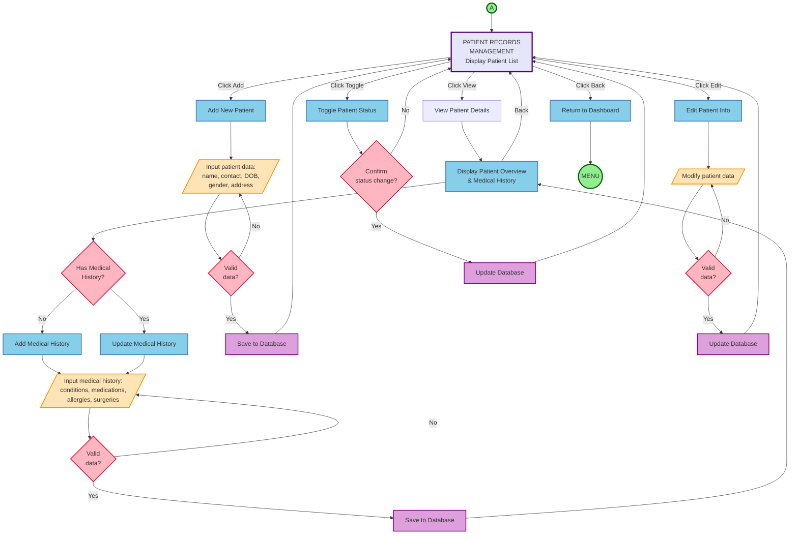

# Program Flowchart - Patient Records Management (Connector A)

## Simplified with Medical History and Database Operations

This flowchart shows the complete patient records workflow with generalized medical history management and explicit database operations.

---

## 📊 **PATIENT RECORDS MANAGEMENT FLOWCHART**



---

## 🔄 **COMPLETE LOGIC FLOW**

```
(A) → PATIENT RECORDS MANAGEMENT
         ↓
    ├─ Add Patient → Input → Validate → Save to Database → Back to List
    │
    ├─ View Patient → Show Details & Medical History
    │                      ↓
    │                 Has Medical History?
    │                 ├─ No → Add Medical History → Input → Validate → Save → Show Details
    │                 └─ Yes → Update Medical History → Input → Validate → Save → Show Details
    │                      ↓
    │                 Back to List
    │
    ├─ Edit Patient → Input → Validate → Update Database → Back to List
    │
    ├─ Toggle Status → Confirm → Update Database → Back to List
    │
    └─ Back → Return to MENU
```

---

## 📋 **KEY FEATURES**

### **1. Patient Management** ✅
- Add new patient
- View patient details
- Edit patient info
- Toggle status (Active/Inactive)

### **2. Medical History Management** ✅ (Generalized)
- Check if medical history exists
- Add medical history (if none)
- Update medical history (if exists)
- Includes: conditions, medications, allergies, surgeries

### **3. Database Operations** ✅ (Explicit)
- **Save to Database** - For new records
- **Update Database** - For modifications
- Shows data persistence clearly

### **4. Validation** ✅
- Input validation for all data entry
- Confirmation for status changes
- Loop back on invalid data

---

## 💡 **WHY THIS APPROACH WORKS**

### **Simplified Medical Records:**
- ❌ Not: "Add Condition", "Add Medication", "Add Allergy", "Add Surgery"
- ✅ Instead: "Add/Update Medical History" (generalized)

### **Explicit Database Operations:**
- Shows **where data is saved**
- Makes data flow clear
- Demonstrates understanding of persistence

### **Balanced Detail:**
- Not too simple (shows medical history)
- Not too complex (generalizes details)
- ~15 boxes total - clean and readable

---

## 🎯 **THESIS CAPTION**

> **Figure X: Patient Records Management Program Flowchart**
> 
> This flowchart illustrates the patient records management module with integrated medical history management. The doctor can add, view, edit, or toggle patient status. When viewing patient details, the system checks if medical history exists and allows the doctor to add or update it accordingly. All operations include validation and explicit database persistence, ensuring data integrity throughout the workflow.

---

## ✅ **PERFECT BALANCE ACHIEVED**

This version:
- ✅ Shows medical history management (your suggestion)
- ✅ Includes database operations (your request)
- ✅ Keeps it generalized (not overwhelming)
- ✅ Clean and professional (~15 boxes)
- ✅ Thesis-ready and defensible

---

**This is the final version! Ready to proceed with Connector B (Appointments)?**