# Program Flowchart - Consultation Management (Connector C)

## Doctor Consultation Workflow (SOAP Format - Sequential)

This flowchart shows the complete consultation workflow following the SOAP format in sequential order.

---

## 📊 **CONSULTATION MANAGEMENT FLOWCHART**

```mermaid
flowchart TB
    %% START
    C((C))
    
    %% MAIN MODULE
    Module[CONSULTATION<br/>MANAGEMENT<br/>Display Consultation Form]
    
    %% CHECK DRAFT
    HasDraft{Existing<br/>draft?}
    CreateNew[Create New Consultation]
    LoadDraft[Load Existing Draft]
    
    %% SECTION 1: SYMPTOMS
    Symptoms[SECTION 1:<br/>SYMPTOMS<br/>Subjective]
    InputSymptoms[/Input symptoms data:<br/>complaints, visit type,<br/>template responses/]
    ValidSymptoms{Valid<br/>symptoms?}
    
    %% SECTION 2: EXAMINATION
    Examination[SECTION 2:<br/>EXAMINATION<br/>Objective]
    InputExam[/Input examination data:<br/>vitals, physical exam,<br/>system findings/]
    ValidExam{Valid<br/>examination?}
    
    %% SECTION 3: DIAGNOSIS
    Diagnosis[SECTION 3:<br/>DIAGNOSIS<br/>Assessment]
    InputDiagnosis[/Input diagnosis data:<br/>ICD-10 codes,<br/>prescriptions/]
    ValidDiagnosis{Valid<br/>diagnosis?}
    
    %% SECTION 4: PLAN
    Plan[SECTION 4:<br/>PLAN & NOTES<br/>Plan]
    InputPlan[/Input plan data:<br/>treatment plan,<br/>follow-up instructions/]
    ValidPlan{Valid<br/>plan?}
    
    %% COMPLETE FLOW
    Complete[Complete Consultation]
    ConfirmComplete{Confirm<br/>complete?}
    FinalizeConsult[Finalize Consultation<br/>Save to Database]
    UpdateAppointment[Update Appointment<br/>Status to Completed]
    GenerateSummary[Generate Consultation<br/>Summary]
    
    %% END
    End([END])
    
    %% MAIN SEQUENTIAL FLOW
    C --> Module
    Module --> HasDraft
    
    HasDraft -->|Yes| LoadDraft
    HasDraft -->|No| CreateNew
    
    CreateNew --> Symptoms
    LoadDraft --> Symptoms
    
    %% SECTION 1: SYMPTOMS
    Symptoms --> InputSymptoms
    InputSymptoms --> ValidSymptoms
    ValidSymptoms -->|No| InputSymptoms
    ValidSymptoms -->|Yes| Examination
    
    %% SECTION 2: EXAMINATION
    Examination --> InputExam
    InputExam --> ValidExam
    ValidExam -->|No| InputExam
    ValidExam -->|Yes| Diagnosis
    
    %% SECTION 3: DIAGNOSIS
    Diagnosis --> InputDiagnosis
    InputDiagnosis --> ValidDiagnosis
    ValidDiagnosis -->|No| InputDiagnosis
    ValidDiagnosis -->|Yes| Plan
    
    %% SECTION 4: PLAN
    Plan --> InputPlan
    InputPlan --> ValidPlan
    ValidPlan -->|No| InputPlan
    ValidPlan -->|Yes| Complete
    
    %% COMPLETE CONSULTATION
    Complete --> ConfirmComplete
    ConfirmComplete -->|No| Plan
    ConfirmComplete -->|Yes| FinalizeConsult
    FinalizeConsult --> UpdateAppointment
    UpdateAppointment --> GenerateSummary
    GenerateSummary --> End
    
    %% STYLING
    classDef startStyle fill:#90EE90,stroke:#006400,stroke-width:3px
    classDef inputStyle fill:#FFE4B5,stroke:#FF8C00,stroke-width:2px
    classDef decisionStyle fill:#FFB6C1,stroke:#DC143C,stroke-width:2px
    classDef processStyle fill:#87CEEB,stroke:#4682B4,stroke-width:2px
    classDef moduleStyle fill:#E6E6FA,stroke:#4B0082,stroke-width:3px
    classDef dbStyle fill:#DDA0DD,stroke:#8B008B,stroke-width:2px
    classDef sectionStyle fill:#B0E0E6,stroke:#4682B4,stroke-width:2px
    
    class C,End startStyle
    class InputSymptoms,InputExam,InputDiagnosis,InputPlan inputStyle
    class HasDraft,ValidSymptoms,ValidExam,ValidDiagnosis,ValidPlan,ConfirmComplete decisionStyle
    class Complete processStyle
    class Module moduleStyle
    class CreateNew,LoadDraft,FinalizeConsult,UpdateAppointment,GenerateSummary dbStyle
    class Symptoms,Examination,Diagnosis,Plan sectionStyle
```



---

## 🔄 **LOGIC FLOW (Sequential)**

```
(C) → CONSULTATION MANAGEMENT
      Display Consultation Form
         ↓
    Existing draft?
    ├─ Yes → Load Existing Draft
    └─ No → Create New Consultation
         ↓
    ┌─────────────────────────────────────┐
    │ SECTION 1: SYMPTOMS (Subjective)   │
    │ Input → Validate → Continue         │
    └─────────────────────────────────────┘
         ↓
    ┌─────────────────────────────────────┐
    │ SECTION 2: EXAMINATION (Objective)  │
    │ Input → Validate → Continue         │
    └─────────────────────────────────────┘
         ↓
    ┌─────────────────────────────────────┐
    │ SECTION 3: DIAGNOSIS (Assessment)   │
    │ Input → Validate → Continue         │
    └─────────────────────────────────────┘
         ↓
    ┌─────────────────────────────────────┐
    │ SECTION 4: PLAN & NOTES (Plan)      │
    │ Input → Validate → Continue         │
    └─────────────────────────────────────┘
         ↓
    Complete Consultation
         ↓
    Confirm complete?
    ├─ No → Back to Plan Section
    └─ Yes → Finalize Consultation (Save to Database)
             ↓
           Update Appointment Status to Completed
             ↓
           Generate Consultation Summary
             ↓
           END
```

---

## 📋 **KEY FEATURES**

### **1. Sequential Workflow** ✅ (SOAP Format)
- **Section 1: Symptoms** - Subjective (what patient tells)
- **Section 2: Examination** - Objective (what doctor observes)
- **Section 3: Diagnosis** - Assessment (doctor's diagnosis + prescriptions)
- **Section 4: Plan & Notes** - Plan (treatment plan, follow-up)

### **2. Draft Management** ✅
- Checks if existing draft consultation exists
- Loads draft if found (resume where left off)
- Creates new consultation if none

### **3. Data Validation** ✅
- Each section validates input before continuing
- Loop back on invalid data
- Must complete sections in order (1→2→3→4)
- Ensures complete SOAP documentation

### **4. Auto-Save Feature** ✅
- System auto-saves every 30 seconds (background)
- Not shown in flowchart (automatic process)
- Prevents data loss

### **5. Completion Process** ✅
- Confirmation before finalizing
- Saves final consultation to database
- Updates consultation status to "completed"
- Updates linked appointment status
- Generates consultation summary

---

## 💡 **WORKFLOW EXPLANATION**

### **Entry Point:**
```
Doctor clicks "Start Consultation" from Appointment (Connector B)
  ↓
System checks: Does draft consultation exist?
  ├─ Yes → Load existing draft (resume where left off)
  └─ No → Create new consultation record
  ↓
Display Section 1: Symptoms
```

### **Section 1: Symptoms (Subjective)**
```
System displays Symptoms section
  ↓
Doctor inputs symptoms data:
  - Chief complaints (Cough, Fever, etc.)
  - Visit type (Acute Illness, Follow-up, etc.)
  - Template responses (duration, severity, etc.)
  - Associated symptoms
  ↓
Valid symptoms?
  ├─ No → Loop back to input
  └─ Yes → Continue to Examination section
```

### **Section 2: Examination (Objective)**
```
System displays Examination section
  ↓
Doctor inputs examination data:
  - Vital signs (temp, BP, pulse, etc.)
  - Physical examination findings
  - System-specific findings (HEENT, Respiratory, etc.)
  ↓
Valid examination?
  ├─ No → Loop back to input
  └─ Yes → Continue to Diagnosis section
```

### **Section 3: Diagnosis (Assessment)**
```
System displays Diagnosis section
  ↓
Doctor inputs diagnosis data:
  - ICD-10 diagnosis codes
  - Primary/secondary diagnoses
  - Prescriptions (medicines, dosage, duration)
  - Clinical notes
  ↓
Valid diagnosis?
  ├─ No → Loop back to input
  └─ Yes → Continue to Plan section
```

### **Section 4: Plan & Notes**
```
System displays Plan section
  ↓
Doctor inputs plan data:
  - Treatment plan
  - Patient education
  - Follow-up instructions
  - Doctor's internal notes
  ↓
Valid plan?
  ├─ No → Loop back to input
  └─ Yes → Continue to Complete Consultation
```

### **Complete Consultation:**
```
Doctor clicks "Complete Consultation"
  ↓
System asks: Confirm complete?
  ├─ No → Back to Plan section
  └─ Yes → Finalize consultation (Save to database)
           ↓
         Update consultation status to "completed"
           ↓
         Update appointment status to "completed"
           ↓
         Generate consultation summary
           ↓
         END (return to patient overview)
```

---

## 🎯 **ALIGNMENT WITH YOUR SYSTEM**

| Flowchart Element | Your System Implementation |
|-------------------|---------------------------|
| Display Consultation Form | `consultations.show` → `show()` |
| Check Existing Draft | `Consultation::where('status', 'draft')` |
| Create New Consultation | `Consultation::create()` |
| Load Existing Draft | `redirect()->route('consultations.show')` |
| Section 1: Symptoms | `current_section = 'symptoms'` |
| Section 2: Examination | `current_section = 'examination'` |
| Section 3: Diagnosis | `current_section = 'diagnosis'` |
| Section 4: Plan | `current_section = 'plan'` |
| Auto-Save (Background) | `saveDraft()` method (every 30s) |
| Finalize Consultation | `finalize()` method |
| Update Appointment | `appointment->update(['status' => 'completed'])` |
| Generate Summary | `summary()` method |

---

## 🎓 **THESIS CAPTION**

> **Figure X: Consultation Management Program Flowchart**
> 
> This flowchart illustrates the doctor's consultation workflow following the SOAP format (Subjective, Objective, Assessment, Plan). The system checks for existing draft consultations and guides the doctor through four sequential sections: Symptoms (Subjective), Examination (Objective), Diagnosis (Assessment), and Plan & Notes (Plan). Each section validates input before proceeding to the next section. The system auto-saves data in the background to prevent data loss. When all sections are complete, the doctor finalizes the consultation, which saves the final data to the database, updates the consultation and appointment statuses, and generates a consultation summary.
> 
> **Note:** While the system provides tabs for flexible navigation between sections, this flowchart shows the recommended sequential workflow following standard medical documentation practices.

---

## ✅ **SUMMARY**

**Connector C (Consultation) includes:**
- ✅ Draft management (resume or create new)
- ✅ 4 sequential sections (Symptoms → Examination → Diagnosis → Plan)
- ✅ SOAP format workflow (Subjective → Objective → Assessment → Plan)
- ✅ Input validation for each section
- ✅ Auto-save in background (not shown in flowchart)
- ✅ Completion confirmation
- ✅ Final save to database on completion
- ✅ Status updates (consultation + appointment)
- ✅ Summary generation
- ✅ Clean sequential structure
- ✅ ~20 boxes - balanced detail

---

**Generated:** December 28, 2025
**Status:** Ready for your review and drawing
**Consistency:** ✅ Follows sequential approach, cleaner than navigation approach
